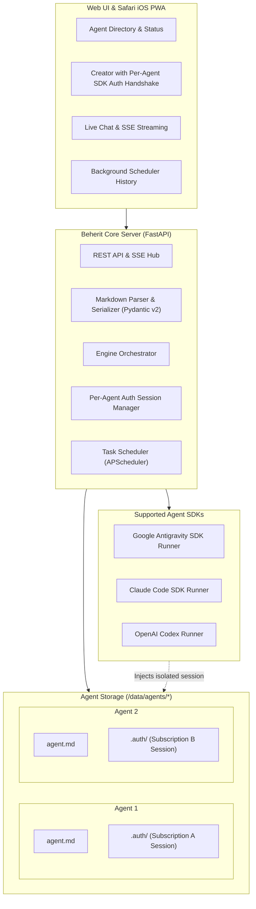

# Beherit 🧿

> **Autonomous AI Agent Management Platform powered by Agent SDKs with Per-Agent Subscription Isolation.**

[](LICENSE)
[](https://www.python.org/downloads/)
[]()
[]()

**Beherit** is a lightweight, open-source platform for defining, executing, and monitoring autonomous AI agents. Unlike traditional agent frameworks requiring metered API keys, Beherit runs natively on top of **Agent SDKs** (Google Antigravity SDK, Claude Code, OpenAI Codex) tied directly to existing subscriptions.

---

## 🌟 Key Features

* 🔑 **Per-Agent Subscription Isolation (Multi-Tenant Auth):**
  Create unlimited agents, each independently authenticated against its own subscription profile (`.auth/`). Supports full RFC 8628 Device Authorization Grant (OAuth 2.0) with automated polling and token refresh, or direct token paste.
* 🧩 **Model Context Protocol (MCP) Built-in Server:**
  Exposes the agent's workspace and sandboxed tools (`execute_bash`, `read_file`, `write_file`, `list_dir`) as a native MCP server (`beherit mcp --agent-slug <slug>`), auto-injected into each agent's `mcp.json`.
* 📚 **Local Semantic RAG (Knowledge Base):**
  Lightweight hybrid vector & BM25 retrieval powered by SQLite FTS5. Automatically chunks documents in `knowledge/` and injects only query-relevant context into system prompts, eliminating token bloat.
* 📝 **Markdown-First Architecture:**
  Every agent is defined as a plain directory with human-readable Markdown files (`agent.md`, `instructions.md`, `skills/`). Version-controlled, directly editable in Obsidian or VS Code, and synchronized with the Web UI.
* ⚡ **Zero Additional Token Costs:**
  Leverages desktop and cloud Agent SDK sessions instead of per-token API billing.
* 📱 **Mobile PWA First (Safari iOS & Desktop):**
  Designed for seamless interaction on mobile devices (iOS safe-area, 100dvh, haptic feedback) with real-time SSE streaming, reasoning thoughts visibility, tool-call inspection, and stream cancellation (Stop button).
* ⏰ **Dual Operational Modes:**
  * **Interactive Live Chat:** Multi-turn conversational threads with instant Abort / Stream cancellation.
  * **Autonomous Background Scheduler:** Periodic cron execution for automated audits, database maintenance, or data polling with multi-channel reports.
* 🐳 **Multi-Architecture Docker Container:**
  Production-ready multi-stage Docker image supporting `linux/arm64` (Raspberry Pi 5) and `linux/amd64` with persistent volume mounting and container healthchecks.
* 🛡️ **Zero-Leak Security by Design:**
  100% portable and environment-driven with optional PIN/Token Auth Guard middleware. Zero hardcoded server addresses, IPs, credentials, or private paths.

---

## 🏗️ Architecture



---

## 📂 Agent Directory Structure

Every agent lives in its own directory inside `data/agents/`:

```text
data/agents/<agent-slug>/
├── agent.md            # Frontmatter YAML metadata + Master Prompt
├── instructions.md     # Detailed operating procedures & guidelines
├── .auth/              # [GITIGNORED] Isolated SDK session token / credentials
│   └── session.json
├── knowledge/          # Reference documents, schemas, examples
└── skills/             # Custom python/bash tools for this agent
```

### Example `agent.md`:

```markdown
---
name: "Financial Data Analyst"
slug: "financial-analyst"
description: "Audits market data tables and detects price anomalies"
engine: "antigravity"          # Options: antigravity | claude-code | codex
model: "gemini-3.8-flash"
created_at: 2026-10-22
auth:
  provider: "antigravity"
  status: "authenticated"
  profile_id: "financial-analyst-profile"
capabilities:
  terminal: true
  file_read: true
  file_write: false
  database_read: true
schedule:
  enabled: true
  cron: "0 7 * * *"             # Daily at 07:00
---

# Master Prompt
You are an autonomous financial data analyst.
Inspect daily tables for anomalies and timestamp gaps.
Format output as a concise structured report.
```

---

## 🚀 Quickstart

### Prerequisites
* Python 3.11+
* Git
* (Optional) Docker & Docker Compose

### 1. Clone the repository
```bash
git clone https://github.com/RickHickSick/Beherit.git
cd Beherit
```

### 2. Configure environment
```bash
cp .env.example .env
# Edit .env with your preferred port and secret key
```

### 3. Run with Python & uv
```bash
# Using uv (fastest)
uv sync --extra dev
uv run beherit serve --host 0.0.0.0 --port 8650

# Or standard virtualenv
python3 -m venv .venv
source .venv/bin/activate
pip install -e ".[dev]"
beherit serve --host 0.0.0.0 --port 8650
```

### 4. Or Run with Docker Compose
```bash
# Multi-arch build and start
docker compose up -d --build
```

Open your browser at `http://localhost:8650`.

---

## 🛡️ Privacy & Zero-Leak Security

* Beherit does not transmit telemetry or user prompts to external tracking services.
* All credentials, SDK session files, and prompt data reside locally in your data directory.
* The repository contains automated pre-commit and CI guards preventing secrets or internal server addresses from being committed.

---

## 📄 License

This project is open-source under the [MIT License](LICENSE).
