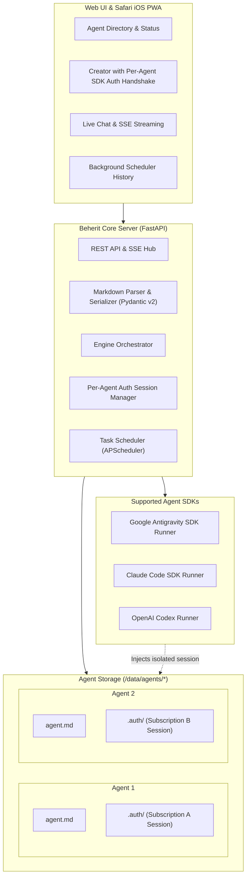

<p align="center">
  
</p>

# Beherit 🧿

> **Autonomous AI Agent Management Platform powered by Agent SDKs with Per-Agent Subscription Isolation.**

[](LICENSE)
[](https://www.python.org/downloads/)
[](CHANGELOG.md)
[]()
[]()

**Beherit** is a lightweight, open-source platform for defining, executing, and monitoring autonomous AI agents. Unlike traditional agent frameworks requiring metered API keys, Beherit runs natively on top of **Agent SDKs** (Google Antigravity SDK, Claude Code, OpenAI Codex) tied directly to existing subscriptions.

---

## 🌟 Key Features

* 🐝 **Multi-Agent Swarm & Delegation (v0.4.0):**
  Agents can autonomously delegate subtasks to other specialized agents via `call_agent` with built-in recursion guard (`max_depth=3`) and live delegation tree visualization.
* 🧠 **Persistent Long-Term Memory (v0.4.0):**
  Per-agent `memory.md` knowledge store allowing agents to remember key user facts, preferences, and operational rules across sessions (`save_memory`, `recall_memory`, `forget_memory`).
* 🎯 **Autonomous Goal Loop & Todo Scratchpad (v0.4.0):**
  Self-directed task breakdown and execution tracking via `todo.md` with Kanban/Todo board in UI and automated status updates (`read_todos`, `update_todo`, `add_todo`).
* 👁️ **Inbound Multimodal Vision in Chat (v0.4.0):**
  Drag-and-drop image and PDF uploads directly in the chat interface with live previews and seamless vision processing across Gemini, Claude, and Antigravity engines.
* 📋 **Bidirectional Plane API Integration (v0.4.0):**
  Built-in agent tools to query, create, update, and comment on tasks within Plane project management (`plane_list_issues`, `plane_create_issue`, `plane_update_state`, `plane_add_comment`).
* ⚡ **Dynamic Scriptable Skills (v0.4.0):**
  Custom per-agent skills loaded dynamically from `skills/*.sh`, `*.py`, or `*.md` with automated tool synthesis and in-browser Skill Editor.
* 🕸️ **Graph RAG & Obsidian Wikilinks Traversal (v0.4.0):**
  Parses Obsidian `[[wikilinks]]` to build knowledge graphs with 1-hop and 2-hop contextual expansion and visual relationship explorer (`query_knowledge_graph`).
* 🤖 **Bidirectional Telegram Bot Integration (v0.4.0):**
  Embedded long-polling Telegram bot supporting multi-turn chats, streaming responses, agent switching (`/agent`), task inspection (`/todo`), and push alerts (`send_telegram_notification`).
* 🔒 **Hardened Bubblewrap Sandbox (v0.4.0):**
  Unprivileged container isolation for bash execution (`bwrap`) with read-only system mounts, private `/tmp`, process namespace unsharing, and graceful container fallback.
* 🔑 **Per-Agent Subscription Isolation (Multi-Tenant Auth):**
  Create unlimited agents, each independently authenticated against its own profile (`.auth/`). Connect easily via CLI SDK session tokens or direct API keys (Google Gemini, Anthropic Claude, OpenAI) with 1-click server import.
* 🧩 **Model Context Protocol (MCP) Built-in Server:**
  Exposes the agent's workspace and sandboxed tools (`execute_bash`, `read_file`, `write_file`, `list_dir`) as a native MCP server (`beherit mcp --agent-slug <slug>`), auto-injected into each agent's `mcp.json`.
* 📚 **Local Semantic RAG (Knowledge Base):**
  Lightweight hybrid vector & BM25 retrieval powered by SQLite FTS5. Automatically chunks documents in `knowledge/` and injects only query-relevant context into system prompts, eliminating token bloat.
* 📝 **Markdown-First Architecture:**
  Every agent is defined as a plain directory with human-readable Markdown files (`agent.md`, `instructions.md`, `memory.md`, `todo.md`, `skills/`). Version-controlled, directly editable in Obsidian or VS Code, and synchronized with the Web UI.
* ⚡ **Zero Additional Token Costs:**
  Leverages desktop and cloud Agent SDK sessions instead of per-token API billing.
* 📱 **Mobile PWA First (Safari iOS & Desktop):**
  Designed for seamless interaction on mobile devices (iOS safe-area, 100dvh, haptic feedback) with real-time SSE streaming, reasoning thoughts visibility, tool-call inspection, and stream cancellation (Stop button).
* 💬 **Chat Session Management:**
  Create named conversation threads, edit titles on the fly, and safely delete chats with cascading SQLite message cleanup.
* 📖 **In-App Interactive Manual & Guide:**
  Full-featured documentation view right inside the application with instant live search and chapter filters. Also available in [docs/MANUAL.md](docs/MANUAL.md).
* ⏰ **Dual Operational Modes:**
  * **Interactive Live Chat:** Multi-turn conversational threads with instant Abort / Stream cancellation.
  * **Autonomous Background Scheduler:** Periodic cron execution for automated audits, database maintenance, or data polling with multi-channel reports.
* 🐳 **Multi-Architecture Docker Container:**
  Production-ready multi-stage Docker image supporting `linux/arm64` (Raspberry Pi 5) and `linux/amd64` with persistent volume mounting and container healthchecks.
* 🛡️ **Zero-Leak Security by Design:**
  100% portable and environment-driven with optional PIN/Token Auth Guard middleware. Zero hardcoded server addresses, IPs, credentials, or private paths.

---

## 🏗️ Architecture



---

## 📂 Agent Directory Structure

Every agent lives in its own directory inside `data/agents/`:

```text
data/agents/<agent-slug>/
├── agent.md            # Frontmatter YAML metadata + Master Prompt
├── instructions.md     # Detailed operating procedures & guidelines
├── .auth/              # [GITIGNORED] Isolated SDK session token / credentials
│   └── session.json
├── knowledge/          # Reference documents, schemas, examples
└── skills/             # Custom python/bash tools for this agent
```

### Example `agent.md`:

```markdown
---
name: "Financial Data Analyst"
slug: "financial-analyst"
description: "Audits market data tables and detects price anomalies"
engine: "antigravity"          # Options: antigravity | claude-code | codex
model: "gemini-3.8-flash"
created_at: 2026-10-22
auth:
  provider: "antigravity"
  status: "authenticated"
  profile_id: "financial-analyst-profile"
capabilities:
  terminal: true
  file_read: true
  file_write: false
  database_read: true
schedule:
  enabled: true
  cron: "0 7 * * *"             # Daily at 07:00
---

# Master Prompt
You are an autonomous financial data analyst.
Inspect daily tables for anomalies and timestamp gaps.
Format output as a concise structured report.
```

---

## 🚀 Quickstart

### Prerequisites
* Python 3.11+
* Git
* (Optional) Docker & Docker Compose

### 1. Clone the repository
```bash
git clone https://github.com/RickHickSick/Beherit.git
cd Beherit
```

### 2. Configure environment
```bash
cp .env.example .env
# Edit .env with your preferred port and secret key
```

### 3. Run with Python & uv
```bash
# Using uv (fastest)
uv sync --extra dev
uv run beherit serve --host 0.0.0.0 --port 8650

# Or standard virtualenv
python3 -m venv .venv
source .venv/bin/activate
pip install -e ".[dev]"
beherit serve --host 0.0.0.0 --port 8650
```

### 4. Or Run with Docker Compose
```bash
# Multi-arch build and start
docker compose up -d --build
```

Open your browser at `http://localhost:8650`.

---

## 🛡️ Privacy & Zero-Leak Security

* Beherit does not transmit telemetry or user prompts to external tracking services.
* All credentials, SDK session files, and prompt data reside locally in your data directory.
* The repository contains automated pre-commit and CI guards preventing secrets or internal server addresses from being committed.

---

## 📄 License

This project is open-source under the [MIT License](LICENSE).
