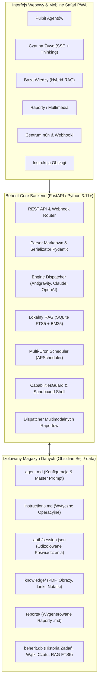

# Beherit — Oficjalny Podręcznik Użytkownika i Instrukcja Obsługi

> **Wersja:** v0.3.0  
> **Projekt:** Beherit — Autonomiczna Platforma Agentów AI  
> **Architektura:** Markdown-First · Per-Agent SDK Isolation · Zero API Token Costs · Local Hybrid RAG  
> **Zarządzanie Zadaniami:** System Plane (`BEH-000` do `BEH-056`)

---

## Spis Treści
1. [Wprowadzenie i Filozofia Projektu](#1-wprowadzenie-i-filozofia-projektu)
2. [Szybki Start (Quickstart w 3 Krokach)](#2-szybki-start-quickstart-w-3-krokach)
3. [Jak Podłączyć Agenta — Przewodnik Uwierzytelniania SDK & API](#3-jak-podłączyć-agenta--przewodnik-uwierzytelniania-sdk--api)
   - [Subskrypcja SDK vs Klucz API — Różnice i Koszty](#subskrypcja-sdk-vs-klucz-api--różnice-i-koszty)
   - [Google Antigravity SDK & Gemini API](#google-antigravity-sdk--gemini-api)
   - [Anthropic Claude Code SDK & Claude API](#anthropic-claude-code-sdk--claude-api)
   - [OpenAI Codex & OpenAI API](#openai-codex--openai-api)
   - [Lokalne Modele LLM (Ollama)](#lokalne-modele-llm-ollama)
   - [Weryfikacja Połączenia: Auth Healthcheck](#weryfikacja-połączenia-auth-healthcheck)
4. [Przegląd Możliwości i Architektury Beherit](#4-przegląd-możliwości-i-architektury-beherit)
   - [Struktura Danych Markdown-First i Integracja z Obsidian](#struktura-danych-markdown-first-i-integracja-z-obsidian)
   - [Interaktywny Czat na Żywo, Myśli (Thinking) i Anulowanie (Abort)](#interaktywny-czat-na-żywo-myśli-thinking-i-anulowanie-abort)
   - [Wielozadaniowy Harmonogram w Tle (Multi-Cron)](#wielozadaniowy-harmonogram-w-tle-multi-cron)
   - [Lokalna Baza Wiedzy (Hybrid RAG: FTS5 + BM25)](#lokalna-baza-wiedzy-hybrid-rag-fts5--bm25)
   - [Multimodalne Raporty i Wykrywanie Artefaktów](#multimodalne-raporty-i-wykrywanie-artefaktów)
   - [Piaskownica Uprawnień Terminala (CapabilitiesGuard)](#piaskownica-uprawnień-terminala-capabilitiesguard)
   - [Model Context Protocol (MCP) — Wbudowany Serwer i Klocki Integracji](#model-context-protocol-mcp--wbudowany-serwer-i-klocki-integracji)
   - [Bezpieczeństwo Zero-Leak i Blokada PIN/Token](#bezpieczeństwo-zero-leak-i-blokada-pintoken)
5. [Szczegółowy Słownik Funkcji i Elementów Interfejsu (UI)](#5-szczegółowy-słownik-funkcji-i-elementów-interfejsu-ui)
   - [Pulpit Główny i Karta Agenta](#pulpit-główny-i-karta-agenta)
   - [Kreator i Edycja Agenta (Wszystkie Pola)](#kreator-i-edycja-agenta-wszystkie-pola)
   - [Okno Czatu (Wątki, Myśli, Narzędzia, Stop)](#okno-czatu-wątki-myśli-narzędzia-stop)
   - [Menedżer Bazy Wiedzy (Knowledge Base)](#menedżer-bazy-wiedzy-knowledge-base)
   - [Panel Historii i Podgląd Raportów](#panel-historii-i-podgląd-raportów)
6. [Automatyzacja i Integracja z n8n oraz Zewnętrznymi Systemami](#6-automatyzacja-i-integracja-z-n8n-oraz-zewnętrznymi-systemami)
   - [Uniwersalny Webhook REST API (`POST /api/agents/{slug}/run`)](#uniwersalny-webhook-rest-api-post-apiagentsslugrun)
   - [Szablon Węzła HTTP Request w n8n](#szablon-węzła-http-request-w-n8n)
   - [Przykłady cURL i Skryptów Bash](#przykłady-curl-i-skryptów-bash)
7. [Referencja REST API i Poleceń CLI](#7-referencja-rest-api-i-poleceń-cli)
8. [Najczęściej Zadawane Pytania (FAQ) i Rozwiązywanie Problemów](#8-najczęściej-zadawane-pytania-faq-i-rozwiązywanie-problemów)

---

## 1. Wprowadzenie i Filozofia Projektu

**Beherit** to otwartoźródłowa (Open-Source, licencja MIT), lekka platforma do orkiestracji, uruchamiania i monitorowania autonomicznych agentów sztucznej inteligencji. Została zaprojektowana z myślą o pracy na lokalnych stacjach roboczych, domowych serwerach (**Raspberry Pi 5 / Homelab**) oraz serwerach VPS.

### Główne filary architektoniczne:
1. **Niezależne profile uwierzytelnienia per agent (Multi-Tenant Auth Isolation):**  
   Każdy agent posiada własny, odizolowany magazyn poświadczeń w podfolderze `.auth/session.json` z prawami `0600`. Różni agenci mogą korzystać z różnych kont, silników i subskrypcji bez ryzyka wycieku czy nadpisywania tokenów.
2. **Zero API Token Costs (Praca na Subskrypcjach SDK):**  
   Dzięki warstwie adapterów pod oficjalne Agent SDK (Google Antigravity CLI, Claude Code), agenci mogą korzystać z nielimitowanych subskrypcji desktopowych użytkownika zamiast generować wysokie rachunki za tokeny API.
3. **Markdown-First & Integracja z Obsidianem:**  
   Cała konfiguracja agenta, jego instrukcje operacyjne, wiedza i raporty to zwykłe pliki Markdown (`agent.md`, `instructions.md`, `reports/*.md`). Brak zamkniętych baz danych — pełna synchronizacja z Obsidianem, VS Code lub systemem kontroli wersji Git.
4. **Lokalny Hybrydowy RAG (Zero Cloud Storage):**  
   Wbudowany silnik wyszukiwania semantycznego oparty na SQLite FTS5 z algorytmem BM25, automatycznym podziałem na fragmenty (chunking) i obsługą formatów PDF, TXT, MD, obrazów i linków internetowych.
5. **Autonomia i Ekosystem Webhooków:**  
   Cykliczne harmonogramy Multi-Cron w tle oraz uniwersalny endpoint webhooka dla n8n z możliwością zapisu wyników bezpośrednio do plików skarbca.

---

## 2. Szybki Start (Quickstart w 3 Krokach)

### Krok 1: Utworzenie Agenta
1. Otwórz panel webowy Beherit (domyślnie `http://localhost:8650` lub adres IP serwera przez Tailscale).
2. Kliknij zielony przycisk **`+ Nowy Agent`** w prawym górnym rogu.
3. Wypełnij:
   - **Nazwa Agenta:** np. `Analityk Rynków`
   - **Opis Agenta:** np. `Monitorowanie danych giełdowych i walut`
   - **Silnik SDK:** wybierz `Google Antigravity SDK` lub `Claude Code SDK`.
   - **Model:** wybierz model z listy (np. `gemini-3.8-flash`).

### Krok 2: Podłączenie Uwierzytelnienia (Auth)
1. W sekcji **Połączenie Agenta** wybierz:
   - **Klucz / Sesja SDK:** kliknij przycisk **`Użyj sesji z serwera`** — Beherit automatycznie wykryje sesję zalogowanego CLI (`~/.gemini` lub `~/.claude`) i zaimportuje ją do katalogu agenta.
   - **Klucz API:** wklej swój prywatny klucz dostawcy (np. `AIzaSy...` dla Google AI Studio lub `sk-ant-...` dla Anthropic).
2. Kliknij **`Przetestuj połączenie`** — zielona odznaka potwierdzi aktywność sesji.
3. Kliknij **`Utwórz Agenta`**.

### Krok 3: Pierwsza Interakcja
- **Tryb Interaktywny:** Kliknij **`💬 Czat`** na kafelku agenta i wyślij pierwsze zapytanie.
- **Tryb Autonomiczny:** Kliknij **`⚡ Uruchom`**, aby wywołać natychmiastowe zadanie i sprawdzić wygenerowany raport w zakładce **Raporty**.

---

## 3. Jak Podłączyć Agenta — Przewodnik Uwierzytelniania SDK & API

### Subskrypcja SDK vs Klucz API — Różnice i Koszty

| Cecha | Subskrypcja SDK (Zalecana) | Klucz API (Direct HTTP API) |
| :--- | :--- | :--- |
| **Model opłat** | **Zero opłat per-token** (w ramach posiadanego abonamentu Pro/Team) | Płatność za milion przetworzonych tokenów wejściowych/wyjściowych |
| **Sposób połączenia** | 1-kliknięcie: import pliku sesji z hosta (`~/.gemini`, `~/.claude`) | Ręczne wklejenie klucza alfanumerycznego |
| **Środowisko** | Narzędzie CLI uruchamiane w podprocesie hosta / kontenera | Bezpośrednie zapytania HTTP REST do API dostawcy |
| **Limity** | Zgodne z limitami subskrypcji użytkownika | Zgodne z limitem kredytowym i tierem konta API |

---

### Google Antigravity SDK & Gemini API

Google Antigravity to oficjalne środowisko agentowe Google DeepMind i Cloud Code.

#### Opcja A: Subskrypcja Antigravity CLI (1-Kliknięcie)
1. Upewnij się, że na hoście wykonano jednorazowe logowanie poleceniem:
   ```bash
   agy
   ```
2. W modalu tworzenia/edycji agenta w Beherit kliknij **`Użyj sesji z serwera`**.
3. Beherit sklonuje plik `~/.gemini/antigravity-cli/.credentials.json` do katalogu `.auth/session.json` agenta z uprawnieniami `chmod 0600`.
4. Gotowe! Agent wykonuje operacje na Twojej subskrypcji Google Antigravity.

#### Opcja B: Klucz Google Gemini API (Darmowy / Płatny)
1. Przejdź do [Google AI Studio](https://aistudio.google.com/) i utwórz klucz API.
2. Skopiuj klucz rozpoczynający się od `AIzaSy...`.
3. W Beherit wklej klucz w polu **Klucz API lub Token Sesji**.
4. Wybierz model, np. `gemini-3.8-flash` lub `gemini-3.8-pro`.

---

### Anthropic Claude Code SDK & Claude API

#### Opcja A: Subskrypcja Claude Code (Claude Pro / Team)
1. Upewnij się, że na hoście wykonano logowanie:
   ```bash
   claude
   ```
2. W kontenerze Docker Beherit wolumen `~/.claude:/root/.claude:ro` jest automatycznie montowany.
3. W panelu Beherit kliknij **`Użyj sesji z serwera`** (wykryje plik `~/.claude/.credentials.json`).

#### Opcja B: Klucz API Anthropic
1. Przejdź do [Anthropic Console](https://console.anthropic.com/settings/keys).
2. Wygeneruj klucz `sk-ant-...`.
3. Wklej klucz w konfiguracji agenta Beherit.
4. Obsługiwane modele: `claude-3-7-sonnet-20250219`, `claude-3-5-sonnet-20241022`, `claude-3-5-haiku-20241022`.

---

### OpenAI Codex & OpenAI API

1. Przejdź do [OpenAI Platform API Keys](https://platform.openai.com/api-keys).
2. Utwórz klucz API w formacie `sk-...`.
3. Wklej klucz w modalu agenta.
4. Obsługiwane modele: `gpt-4o`, `gpt-4o-mini`, `o3-mini`.

---

### Lokalne Modele LLM (Ollama)

1. Uruchom instancję Ollama na serwerze lub hoście (`ollama serve`).
2. Kliknij przycisk **`🔄`** (Odśwież modele) w oknie edycji agenta.
3. Beherit automatycznie pobierze listę zainstalowanych modeli z `http://localhost:11434/api/tags` i udostępni je na liście wyboru.

---

### Weryfikacja Połączenia: Auth Healthcheck

Na karcie każdego agenta oraz w modalu autoryzacji dostępny jest przycisk **`Przetestuj połączenie`** (`POST /api/agents/{slug}/auth/test`).
- 🟢 **Połączono (authenticated):** Poświadczenia są poprawne, token jest aktywny i nie wygasł.
- 🟡 **Wygasły (expired):** Sesja utraciła ważność — kliknij `Użyj sesji z serwera` lub wklej świeży token.
- 🔴 **Brak autoryzacji (unauthenticated):** Agent nie posiada skonfigurowanych danych logowania.

---

## 4. Przegląd Możliwości i Architektury Beherit



### Struktura Danych Markdown-First i Integracja z Obsidian

Dane każdego agenta znajdują się w osobnym katalogu:
```text
data/agents/<agent-slug>/
├── agent.md            # Metadane YAML frontmatter + Master Prompt
├── instructions.md     # Precyzyjne procedury i wytyczne zachowania
├── .auth/              # [UKRYTE / CHMOD 0600] Odizolowany plik session.json
│   └── session.json
├── knowledge/          # Pliki bazy wiedzy (PDF, MD, obrazy, linki)
├── skills/             # Skrypty narzędziowe Pythona i Basha
├── artifacts/          # Wygenerowane obrazy, wykresy, wideo, dane
└── reports/            # Wygenerowane raporty audytowe Markdown
```

> **Wskazówka:** Konfigurując zmienną środowiskową `BEHERIT_AGENTS_DIR` w pliku `.env`, możesz wskazać ścieżkę bezpośrednio do folderu w swoim skarbcu Obsidian, np.:  
> `BEHERIT_AGENTS_DIR=/home/archibald/Obsidian/Notatki/Projekty/Beherit/Agenci`

---

### Interaktywny Czat na Żywo, Myśli (Thinking) i Anulowanie (Abort)

- **Server-Sent Events (SSE):** Natychmiastowe strumieniowanie generowanych słów.
- **Wydzielony Akordeon Myśli (*Thinking Process*):** Rozumowanie modelu jest odseparowane od odpowiedzi końcowej.
- **Inspekcja Narzędzi (*Tool Calls*):** Przejrzysty podgląd wykonywanych poleceń terminala i narzędzi MCP.
- **Przycisk Zatrzymaj (*Cancel Stream*):** W trakcie generowania odpowiedzi dostępny jest czerwony przycisk `Zatrzymaj`. Wysyła on sygnał `SIGTERM`/`SIGKILL` do procesu wykonawczego i bezpiecznie zapisuje dotychczas wygenerowany tekst w SQLite.
- **Pamięć Wieloturowa:** Zapisywanie wątków dialogowych w tabelach `chat_sessions` i `chat_messages` z możliwością tworzenia nowych wątków.

---

### Wielozadaniowy Harmonogram w Tle (Multi-Cron)

Beherit umożliwia definiowanie **nielimitowanej liczby harmonogramów cyklicznych** dla każdego agenta:
- Każde zadanie (`ScheduledJob`) posiada unikalny identyfikator, nazwę, wyrażenie cron (np. `0 8 * * *`), dedykowany prompt oraz opcjonalną ścieżkę pliku docelowego (`destination_file`).
- **Split-button `⚡ Uruchom`:** Umożliwia natychmiastowe uruchomienie wybranego zadania z listy lub wpisanie promptu doraźnego (ad-hoc) w wyskakującym oknie.

---

### Lokalna Baza Wiedzy (Hybrid RAG: FTS5 + BM25)

1. **Obsługiwane Formaty:**
   - Pliki Markdown (`.md`) i tekstowe (`.txt`).
   - Dane tabelaryczne i strukturalne (`.json`, `.csv`, `.tsv`).
   - Dokumenty PDF (`.pdf`) — pełna ekstrakcja treści stron przy użyciu silnika `pypdf`.
   - Obrazy (`.png`, `.jpg`, `.jpeg`, `.webp`, `.svg`, `.gif`) — generowanie metadanych, miniatury i podgląd.
   - Odnośniki internetowe i filmy YouTube — wpisanie URL powoduje automatyczne pobranie tytułu i metadanych przez oEmbed.
2. **Indeksowanie i Ranking BM25:**
   - Dokumenty są dzielone na inteligentne akapity (chunki).
   - Indeks przechowywany jest w lokalnej bazie SQLite z modułem wyszukiwania pełnotekstowego FTS5 i wagami BM25.
3. **Zasada *Source of Truth*:**
   - Informacje pochodzące z bazy wiedzy agenta posiadają w prompcie bezwzględny priorytet nad domyślną wiedzą ogólną LLM.
4. **Testowanie RAG:**
   - W modalu wiedzy dostępna jest zakładka testowa, pozwalająca wpisać frazę i podejrzeć fragmenty dokumentów wraz z punktacją relewancji.

---

### Multimodalne Raporty i Wykrywanie Artefaktów

Po każdym uruchomieniu zadania w tle lub przez webhook Beherit automatycznie skanuje katalog roboczy agenta:
- Wykrywa nowo utworzone pliki w podfolderach `artifacts/`, `output/` i `media/`.
- Klasyfikuje je jako obrazy, wideo, dokumenty lub pliki binarne.
- Osadza miniatury i linki do bezpiecznego endpointu strumieniującego `/api/reports/artifact` w raporcie Markdown.
- Zapisuje historię wykonania w tabeli `job_history`.

---

### Piaskownica Uprawnień Terminala (CapabilitiesGuard)

Dla każdego agenta można zdefiniować jeden z 3 poziomów dostępu do powłoki bash:
1. `Piaskownica (Restricted)`: Domyślny, bezpieczny tryb. Agent może uruchamiać polecenia bash wyłącznie wewnątrz swojego katalogu roboczego. Zablokowana jest ucieczka ścieżkami relatywnymi (`..`), zmiana katalogu na root (`cd /`) oraz dostęp do wrażliwych folderów systemowych (`/etc`, `/proc`, `/sys`, `/root`).
2. `Pełna swoboda (Unrestricted)`: Brak ograniczeń ścieżek — agent działa z uprawnieniami konta systemowego hosta (przydatne do zaawansowanych prac administracyjnych i DevOps).
3. `Wyłączony (Disabled)`: Agent ma całkowity zakaz wywoływania poleceń powłoki bash.

---

### Model Context Protocol (MCP) — Wbudowany Serwer i Klocki Integracji

1. **Wbudowany Serwer MCP Piaskownicy:**
   Beherit udostępnia natywny serwer protokołu MCP komunikujący się przez Stdio JSON-RPC 2.0:
   ```bash
   beherit mcp --agent-slug <slug>
   ```
   Automatycznie eksportuje narzędzia: `execute_bash`, `read_file`, `write_file`, `list_dir`, respektując uprawnienia piaskownicy agenta.
2. **Katalog Wizualnych Klocków MCP:**
   W formularzu edycji agenta można jednym kliknięciem dodać gotowe szablony serwerów MCP:
   - `Brave Search` (Wyszukiwanie live w sieci WWW).
   - `PostgreSQL` (Wykonywanie zapytań SQL do baz danych).
   - `SQLite` (Odczyt i analiza plików baz SQLite).
   - `Filesystem` (Dostęp do wybranych folderów hosta).
   - `GitHub` (Operacje na repozytoriach, issue i PR).
   - `Puppeteer` (Automatyzacja przeglądarki i rendering stron).
   - `Fetch` (Pobieranie stron i konwersja do Markdown).

---

### Bezpieczeństwo Zero-Leak i Blokada PIN/Token

- **Zasada Zero-Leak:** W kodzie źródłowym i publicznym repozytorium GitHub nie ma żadnych prywatnych adresów IP, haseł ani loginów. Wszystko konfigurowane jest w pliku `.env`.
- **PIN / Access Token Guard:** Jeśli w `.env` ustawiono zmienną `BEHERIT_ACCESS_TOKEN`, aplikacja wymaga podania kodu na ekranie blokady, a wszystkie zapytania API są weryfikowane przez bezpieczne porównanie `hmac.compare_digest`.

---

## 5. Szczegółowy Słownik Funkcji i Elementów Interfejsu (UI)

W tej sekcji szczegółowo wyjaśniono działanie każdego przycisku, pola i okna w aplikacji.

### Pulpit Główny i Karta Agenta

| Element UI | Co dokładnie robi ta funkcja? |
| :--- | :--- |
| **Odznaka Silnika i Modelu** | Informuje, jaki silnik SDK (Antigravity, Claude, Codex) oraz model LLM przetwarza zadania agenta. |
| **Odznaka Uwierzytelnienia (Klucz)** | Kolorowy wskaźnik stanu sesji: zielony (`Połączono`), żółty (`Wygasła`), czerwony (`Brak klucza`). Kliknięcie otwiera okno zarządzania kluczem. |
| **Przycisk `⚡ Uruchom` (część główna)** | Natychmiast uruchamia asynchronicznie domyślne zadanie autonomiczne agenta, generuje raport audytowy i zapisuje go w historii. |
| **Strzałka rozwijana `⚡` (Split-button)** | Otwiera menu wyboru: pozwala uruchomić konkretne zadanie z harmonogramu Multi-Cron lub otworzyć okno promptu doraźnego (ad-hoc). |
| **Opcja `Doraźny Prompt (Ad-hoc)`** | Otwiera modal pozwalający wpisać jednorazową dyspozycję dla agenta bez zmieniania jego stałego harmonogramu. |
| **Przycisk `💬 Czat`** | Przełącza widok na okno czatu interaktywnego z tym konkretnym agentem i wczytuje historię ostatniej konwersacji. |
| **Przycisk `📚 Wiedza`** | Otwiera modal menedżera bazy wiedzy RAG: listę dokumentów, formularz uploadu i wyszukiwarkę semantyczną. |
| **Przycisk `🔌 n8n`** | Otwiera centrum integracji webhooków z gotowymi szablonami zapytań HTTP dla n8n oraz poleceniami cURL. |
| **Przycisk `⚙️ Edytuj`** | Otwiera pełne okno modyfikacji konfiguracji agenta (prompty, uprawnienia, harmonogramy, MCP). |
| **Przycisk `🔑 Klucz`** | Otwiera modal zarządzania poświadczeniami SDK/API oraz narzędzie natychmiastowego testu połączenia. |
| **Przycisk `🗑️ Usuń`** | Wyświetla monit potwierdzenia, a po zatwierdzeniu trwale usuwa katalog agenta z dysku oraz kaskadowo czyści powiązane rekordy w SQLite. |

---

### Kreator i Edycja Agenta (Wszystkie Pola)

| Pole formularza | Co dokładnie robi to pole / funkcja? |
| :--- | :--- |
| **Nazwa Agenta (`name`)** | Nazwa wyświetlana na pulpicie, w nagłówkach czatu i w wygenerowanych raportach. |
| **Opis Agenta (`description`)** | Krótka notka informacyjna wyświetlana na kafelku pulpitu, opisująca zadanie i cel agenta. |
| **Slug / Folder (`slug`)** | Unikalny identyfikator techniczny; stanowi nazwę katalogu na dysku/w Obsidianie. Generowany automatycznie z nazwy. |
| **Silnik SDK (`engine`)** | Wybór adaptera środowiska wykonawczego: `Google Antigravity SDK`, `Claude Code SDK` lub `OpenAI Codex`. |
| **Model Silnika (`model`)** | Identyfikator modelu LLM (np. `gemini-3.8-flash`, `claude-3-7-sonnet-20250219`, `gpt-4o`). |
| **Przycisk `🔄` (Odśwież modele)** | Łączy się z API dostawcy i pobiera aktualną listę aktywnych modeli na koncie użytkownika. |
| **Poziom Uprawnień Terminala** | Ustala stopień izolacji powłoki bash: `Piaskownica (Restricted)`, `Pełna swoboda (Unrestricted)` lub `Wyłączony (Disabled)`. |
| **Dostęp do plików (`file_read`, `file_write`)** | Pozwala lub blokuje agentowi możliwość odczytu i zapisu plików w jego przestrzeni roboczej. |
| **Dostęp do bazy danych (`database_read`)** | Pozwala na wykonywanie zapytań SQL przez generyczny ciąg `DATABASE_URL`. |
| **Typ Połączenia (Klucz API vs Sesja SDK)** | Przełącza tryb autoryzacji między subskrypcją CLI a bezpośrednim kluczem API. |
| **Przycisk `Użyj sesji z serwera`** | Automatycznie kopiuje lokalne poświadczenia CLI z serwera (`~/.gemini` lub `~/.claude`) do folderu `.auth/` agenta. |
| **Klucz API lub Token Sesji** | Pole tekstowe na ręczne wprowadzenie klucza API lub tokena autoryzacyjnego. |
| **Przycisk `Przetestuj połączenie`** | Wysyła zapytanie testowe i wyświetla czy poświadczenia są aktywne. |
| **Master Prompt (System Prompt)** | Definicja tożsamości, roli, wiedzy bazowej i celu agenta wstrzykiwana na początku każdej interakcji. |
| **Wytyczne Operacyjne (`instructions.md`)** | Szczegółowe zasady zachowania, szablony tabel Markdown, procedury krok po kroku i zakazy behawioralne. |
| **Klocki MCP (Szybkie dodawanie)** | Wstawia gotowe konfiguracje serwerów MCP (Brave Search, PostgreSQL, SQLite, Filesystem, itp.) do edytora JSON. |
| **Edytor JSON konfiguracji MCP** | Pozwala na precyzyjne definiowanie zewnętrznych serwerów Model Context Protocol per agent. |
| **Harmonogram Multi-Cron** | Umożliwia dodawanie wielu zadań cron (`ScheduledJob`), każde z własnym promptem, harmonogramem i plikiem docelowym. |

---

### Okno Czatu (Wątki, Myśli, Narzędzia, Stop)

| Element okna czatu | Co dokładnie robi ta funkcja? |
| :--- | :--- |
| **Selektor Sesji / Wątku** | Pozwala przełączać się między wieloma wątkami rozmowy z tym samym agentem lub utworzyć nowy czysty wątek (`+ Nowy Wątek`). |
| **Strumień Odpowiedzi (SSE)** | Wyświetla odpowiedź modelu generowaną w czasie rzeczywistym bez oczekiwania na zakończenie całego bloku tekstu. |
| **Zwijany Akordeon Myśli (*Thinking*)** | Ukrywa lub rozwija tok wewnętrznego rozumowania modelu AI, zapobiegając zanieczyszczeniu treści końcowej. |
| **Karty Wywołań Narzędzi (*Tool Calls*)** | Prezentują nazwę uruchomionego narzędzia, przekazane parametry oraz status wykonania. |
| **Przycisk `Zatrzymaj` (Stop)** | Czerwony przycisk pojawiający się podczas generowania odpowiedzi. Przerywa proces modelu (`SIGKILL`) i zachowuje wygenerowany fragment w bazie. |
| **Pole Wprowadzania Wiadomości** | Pole tekstowe z obsługą wieloliniową (Shift+Enter dla nowej linii, Enter dla wysłania), zoptymalizowane pod mobilne Safari iOS. |

---

### Menedżer Bazy Wiedzy (Knowledge Base)

| Element menedżera wiedzy | Co dokładnie robi ta funkcja? |
| :--- | :--- |
| **Tabela Plików Wiedzy** | Wyświetla wszystkie zaindeksowane zasoby agenta: nazwę, typ (MD, PDF, Obraz, Link), rozmiar oraz datę modyfikacji. |
| **Formularz `Dodaj notatkę tekstową`** | Tworzy nowy plik `.md` lub `.txt` bezpośrednio w podfolderze `knowledge/` agenta. |
| **Upload plików (Strefa Drag & Drop)** | Umożliwia przeciągnięcie i upuszczenie plików PDF, obrazów lub dokumentów z dysku komputera. |
| **Formularz `Dodaj link WWW / YouTube`** | Pobiera tytuł i metadane ze wskazanego adresu URL i tworzy zindeksowaną notatkę Markdown. |
| **Przycisk `Podgląd / Raw`** | Otwiera sformatowany podgląd dokumentu Markdown, wyekstrahowany tekst PDF lub miniaturę obrazu. |
| **Przycisk `Usuń zasób`** | Usuwa plik z katalogu `knowledge/` oraz oczyszcza indeks wyszukiwania pełnotekstowego FTS5. |
| **Zakładka `Test RAG`** | Pole testowe do symulacji zapytań semantycznych — wyświetla score BM25 i wyselekcjonowane fragmenty tekstu. |

---

### Panel Historii i Podgląd Raportów

| Element panelu historii | Co dokładnie robi ta funkcja? |
| :--- | :--- |
| **Tabela Zadań** | Zestawienie wykonanych audytów z informacją o nazwie agenta, statusie (`Sukces`/`Błąd`), czasie trwania (sekundy) i dacie. |
| **Odznaki Artefaktów** | Miniaturki wygenerowanych plików (obrazki, wykresy, wideo, dokumenty) osadzone bezpośrednio w wierszu tabeli. |
| **Przycisk `📄 Raport`** | Otwiera modal z pełną treścią raportu renderowaną ze składni Markdown (nagłówki, listy, tabele, obrazy). |
| **Przycisk `Odśwież`** | Ponownie pobiera najnowszą historię zadań z bazy SQLite (`/api/history`). |

---

## 6. Automatyzacja i Integracja z n8n oraz Zewnętrznymi Systemami

Beherit został od podstaw zaprojektowany do współpracy z orkiestratorami procesów, takimi jak **n8n**, skryptami Bash czy zadaniami cron hosta.

### Uniwersalny Webhook REST API (`POST /api/agents/{slug}/run`)

Punkt wejścia:
```http
POST /api/agents/{slug}/run HTTP/1.1
Content-Type: application/json
Authorization: Bearer <BEHERIT_ACCESS_TOKEN>  (opcjonalnie)
```

#### Parametry Payloadu JSON:
- `prompt` *(string, opcjonalny)*: Treść zadania lub zapytania dla agenta (jeśli brak, użyty zostanie prompt domyślny).
- `context` *(object, opcjonalny)*: Dowolny obiekt JSON przekazywany jako dane kontekstowe (np. dane z webhooka sklepu, błąd z n8n).
- `destination_file` *(string, opcjonalny)*: Bezwzględna lub względna ścieżka pliku w skarbcu Obsidian, do którego ma trafić wynik.
- `file_mode` *(string, opcjonalny)*: Tryb zapisu do pliku docelowego:
  - `"overwrite"`: nadpisuje istniejącą treść pliku.
  - `"append"`: dopisuje wynik na końcu pliku (idealne dla dzienników i logów).
- `save_report` *(boolean, opcjonalny)*: Czy wygenerować oficjalny raport audytowy w `reports/` i zapisać w historii SQLite (domyślnie `true`).
- `callback_url` *(string, opcjonalny)*: Adres webhooka n8n, na który Beherit wyśle zapytanie POST po zakończeniu zadania.
- `async_execution` *(boolean, opcjonalny)*: Gdy ustawione na `true`, Beherit natychmiast zwraca `200 OK {"async": true}`, a przetwarzanie odbywa się w tle.

---

### Szablon Węzła HTTP Request w n8n

Skopiuj poniższy kod JSON i wklej go bezpośrednio na tablicę edytora w **n8n** (skrótem `Ctrl+V`):

```json
{
  "nodes": [
    {
      "parameters": {
        "method": "POST",
        "url": "http://100.121.196.113:8650/api/agents/analityk-rynkow/run",
        "sendHeaders": true,
        "headerParameters": {
          "parameters": [
            {
              "name": "Content-Type",
              "value": "application/json"
            }
          ]
        },
        "sendBody": true,
        "specifyBody": "json",
        "jsonBody": "={\n  \"prompt\": \"Przeanalizuj dzisiejsze kursy walut i wskaż odchylenia powyżej 2%\",\n  \"context\": {\n    \"zrodlo\": \"n8n-daily-trigger\",\n    \"data\": \"{{ $now.format('yyyy-MM-dd') }}\"\n  },\n  \"destination_file\": \"Raporty/Rynek-{{ $now.format('yyyy-MM-dd') }}.md\",\n  \"file_mode\": \"overwrite\",\n  \"save_report\": true\n}",
        "options": {}
      },
      "id": "beherit-agent-trigger",
      "name": "Uruchom Agenta Beherit",
      "type": "n8n-nodes-base.httpRequest",
      "typeVersion": 4.2,
      "position": [460, 300]
    }
  ]
}
```

---

### Przykłady cURL i Skryptów Bash

#### 1. Natychmiastowe synchroniczne wywołanie z zapisem do pliku:
```bash
curl -X POST "http://localhost:8650/api/agents/analityk-rynkow/run" \
     -H "Content-Type: application/json" \
     -d '{
       "prompt": "Wygeneruj podsumowanie stanu systemu",
       "destination_file": "Raporty/Status.md",
       "file_mode": "overwrite"
     }'
```

#### 2. Uruchomienie asynchroniczne z powiadomieniem zwrotnym (Callback):
```bash
curl -X POST "http://localhost:8650/api/agents/analityk-rynkow/run" \
     -H "Content-Type: application/json" \
     -d '{
       "prompt": "Długi audyt bazy danych",
       "async_execution": true,
       "callback_url": "http://100.121.196.113:5678/webhook/audyt-gotowy"
     }'
```

---

## 7. Referencja REST API i Poleceń CLI

### Kluczowe Punkty Wejścia REST API

| Metoda | Ścieżka URL | Opis działania |
| :--- | :--- | :--- |
| `GET` | `/api/health` | Status serwera, wersja Beherit i aktywny katalog agentów. |
| `GET` | `/api/agents` | Lista wszystkich zarejestrowanych agentów wraz z ich konfiguracją. |
| `POST` | `/api/agents` | Utworzenie nowego agenta na dysku. |
| `GET` | `/api/agents/{slug}` | Pobranie szczegółowych metadanych konkretnego agenta. |
| `PUT` | `/api/agents/{slug}` | Aktualizacja parametrów, promptów i harmonogramów agenta. |
| `DELETE` | `/api/agents/{slug}` | Bezpieczne usunięcie agenta i kaskadowe wyczyszczenie danych z bazy. |
| `POST` | `/api/agents/{slug}/chat` | Strumieniowy punkt wejścia czatu w czasie rzeczywistym (SSE). |
| `POST` | `/api/agents/{slug}/chat/cancel` | Natychmiastowe przerwanie aktywnego generowania odpowiedzi (`SIGKILL`). |
| `GET` | `/api/agents/{slug}/chats` | Lista wątków i sesji konwersacyjnych agenta. |
| `POST` | `/api/agents/{slug}/run` | Uniwersalny webhook wejściowy dla n8n i zewnętrznych automatyzacji. |
| `POST` | `/api/agents/{slug}/run-now` | Natychmiastowe doraźne uruchomienie zadania cron lub promptu ad-hoc. |
| `POST` | `/api/agents/{slug}/auth/test` | Test poprawności tokena i łączności z silnikiem (Auth Healthcheck). |
| `POST` | `/api/agents/{slug}/auth/import-local` | Sklonowanie lokalnych poświadczeń CLI hosta do folderu `.auth/` agenta. |
| `GET` | `/api/agents/{slug}/knowledge` | Lista dokumentów i zasobów w bazie wiedzy agenta. |
| `POST` | `/api/agents/{slug}/knowledge` | Wgranie nowego pliku do bazy wiedzy (MD, PDF, Obraz). |
| `POST` | `/api/agents/{slug}/knowledge/link` | Zapisanie linku WWW lub wideo YouTube z autodetekcją metadanych. |
| `POST` | `/api/agents/{slug}/knowledge/search` | Odpytanie silnika RAG (BM25) o relevantne fragmenty dokumentów. |
| `GET` | `/api/history` | Rejestr wykonanych audytów i zadań autonomicznych z SQLite. |
| `GET` | `/api/reports/view` | Bezpieczny odczyt wygenerowanego pliku raportu Markdown. |
| `GET` | `/api/reports/artifact` | Strumieniowanie wygenerowanego pliku multimedialnego (obraz, wideo, dane). |

---

### Polecenia Terminalowe CLI (`beherit`)

```bash
# Uruchomienie serwera Beherit na domyślnym lub wskazanym porcie:
beherit serve --host 0.0.0.0 --port 8650

# Lista wszystkich agentów i ich statusów:
beherit list

# Wykonanie doraźnego zadania przez agenta bezpośrednio z terminala:
beherit run analityk-rynkow --prompt "Sprawdź kurs EUR/PLN"

# Sprawdzenie kondycji środowiska i łączności z bazą:
beherit health

# Uruchomienie wbudowanego serwera piaskownicy Model Context Protocol (MCP):
beherit mcp --agent-slug analityk-rynkow
```

---

## 8. Najczęściej Zadawane Pytania (FAQ) i Rozwiązywanie Problemów

### P: Czy logowanie do subskrypcji Antigravity lub Claude jest bezpieczne?
**O:** Tak. Poświadczenia są zapisywane wyłącznie w podfolderze `.auth/session.json` danego agenta z uprawnieniami `0600`. Folder ten jest wpisany do `.gitignore` i nigdy nie trafia do repozytorium kodu ani nie jest współdzielony z innymi agentami.

### P: Jak zmienić domyślny folder przechowywania agentów na Obsidian?
**O:** Otwórz plik `.env` i ustaw zmienną `BEHERIT_AGENTS_DIR`, np.:
```env
BEHERIT_AGENTS_DIR=/home/archibald/Obsidian/Notatki/Projekty/Beherit/Agenci
```
Po restarcie aplikacji agenci będą tworzeni bezpośrednio w wybranym folderze Twojego sejfu Obsidian.

### P: Zapomniałem kodu PIN do panelu (`BEHERIT_ACCESS_TOKEN`). Co zrobić?
**O:** Otwórz plik `.env` na serwerze i sprawdź wartość zmiennej `BEHERIT_ACCESS_TOKEN`. Możesz ją zmienić na nowy ciąg lub zakomentować, aby wyłączyć ekran blokady.

### P: Jak połączyć się z Beherit z iPhone'a poza domem?
**O:** Uruchom aplikację **Tailscale** na telefonie oraz na serwerze Beherit. Wpisz w przeglądarce Safari adres Tailscale serwera z portem `8650` (np. `http://100.121.196.113:8650`). Następnie kliknij *Udostępnij* -> *Do ekranu początkowego*, aby zainstalować aplikację jako pełnoekranowe PWA.

### P: Dlaczego agent nie odpowiada na pytania dotyczące wgranego pliku PDF?
**O:** 1) Sprawdź w modalu wiedzy (`📚 Wiedza`), czy plik ma status poprawnie przetworzonego.  
2) Przejdź do zakładki *Test RAG* w modalu wiedzy i wpisz słowa kluczowe — sprawdź, czy silnik BM25 zwraca fragmenty pliku.  
3) Upewnij się, że w konfiguracji agenta uprawnienie `file_read` jest włączone.
