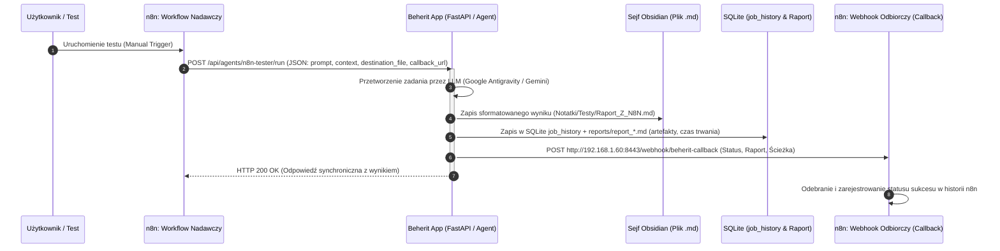

# Scenariusz Testowy: Integracja n8n <-> Beherit Agent (BEH-050)

> **Data utworzenia:** 2026-10-26  
> **Projekt:** Beherit (BEH) · Zadanie `[BEH-050]` (oraz podzadania `BEH-053` – `BEH-056`)  
> **Wersja platformy:** Beherit v0.3.0  
> **Środowisko:** Raspberry Pi 5 (`100.121.196.113` / LAN: `192.168.1.60`)  
> **Aplikacja Beherit:** `http://100.121.196.113:8650/`  
> **Instancja n8n:** `http://100.121.196.113:8443/`  
> **Sejf Obsidian:** `/home/archibald/Obsidian/` (lub ścieżka wolumenu agenta)

---

## 🎯 1. Cel Testu

Przeprowadzenie rzeczywistego testu integracyjnego typu End-to-End, weryfikującego dwukierunkową komunikację pomiędzy platformą **n8n** a agentem w **Beherit v0.3.0**:
1. **n8n -> Beherit:** Przekazanie promptu i dynamicznego kontekstu (zamówienie/ticket) przez webhook REST API.
2. **Autonomiczna praca agenta:** Przetworzenie danych przez LLM agenta, wygenerowanie sformatowanej analizy i **zapisanie pliku wynikowego do Obsidianu**.
3. **Rejestracja audytowa:** Automatyczne odnotowanie wykonania w bazie SQLite `job_history` oraz wygenerowanie multimodalnego raportu `reports/report_*.md`.
4. **Beherit -> n8n (Callback):** Wysłanie zwrotnego powiadomienia HTTP POST na webhook n8n z podsumowaniem, statusem i metadanymi utworzonych artefaktów.

---

## 🏗️ 2. Architektura i Schemat Przepływu



---

## 📋 3. Szczegółowe Kroki Wykonania

### Krok 1: Utworzenie Agenta Testowego w Beherit (`BEH-053`)
1. Otwórz panel Beherit: **`http://100.121.196.113:8650/`**.
2. Kliknij **`+ Nowy Agent`** w prawym górnym rogu.
3. Wypełnij formularz następującymi danymi:
   * **Nazwa Agenta:** `Tester Integracji n8n`
   * **Opis Agenta:** `Agent dedykowany do odbierania i przetwarzania payloadów z workflow n8n`
   * **Slug (Folder):** `n8n-tester`
   * **Silnik SDK:** `Google Antigravity SDK`
   * **Model Silnika:** `Gemini 3.8 Flash (Domyślny, szybki)`
   * **Poziom Uprawnień Terminala:** `Piaskownica`
   * **Połączenie Agenta:** `Klucz / Sesja SDK` -> zaznacz `Użyj sesji serwera` (lub podaj klucz API Gemini).
   * **Master Prompt:**
     ```text
     Jesteś autonomicznym agentem analitycznym platformy Beherit zintegrowanym z ekosystemem n8n.
     Twoim zadaniem jest precyzyjna analiza przekazywanych danych biznesowych, formatowanie podsumowań w czytelnych tabelach Markdown oraz generowanie zaleceń operacyjnych.
     ```
   * **Wytyczne operacyjne:**
     ```text
     1. Zawsze formatuj kluczowe dane w tabeli Markdown.
     2. Odpowiedź ma zawierać: Nagłówek, Tabelę podsumowania, 3 Rekomendowane kolejne kroki.
     3. Zachowaj profesjonalny i zwięzły ton.
     ```
4. Kliknij **`Utwórz Agenta`**.

---

### Krok 2: Import i Konfiguracja Workflow w n8n (`BEH-054`, `BEH-055`)
1. Otwórz n8n na Raspberry Pi: **`http://100.121.196.113:8443/`**.
2. W menu głównym wybierz **`Workflows`** -> **`Add Workflow`**.
3. Kliknij menu `...` (w prawym górnym rogu edytora n8n) -> **`Import from File`** lub **`Import from URL/JSON`**.
4. Wklej zawartość gotowego pliku:
   👉 [`n8n_beherit_test_workflow.json`](file:///home/archibald/Projects/Beherit/testy/003_testy/n8n_beherit_test_workflow.json).
5. Workflow zawiera 2 równoległe gałęzie:
   * **Gałąź 1 (Wyzwalacz):** `1. Uruchom Test Ręcznie` -> `2. Dane Testowe Zamówienia` -> `3. HTTP Request: Wywołaj Agenta Beherit`.
   * **Gałąź 2 (Odbiornik Callback):** `4. Webhook: Odbiór Wyników z Beherit` (`POST /webhook/beherit-callback`) -> `5. Zarejestruj Sukces w n8n`.
6. Kliknij **`Save`** oraz przełącz suwak **`Active`** w prawym górnym rogu na pozycję włączoną (zieloną).

---

### Krok 3: Wykonanie Testu
1. W edytorze workflow n8n kliknij przycisk **`Test step`** na węźle `1. Uruchom Test Ręcznie` lub **`Execute Workflow`**.
2. Obserwuj wykonanie:
   * Węzeł `2. Dane Testowe Zamówienia` generuje przykładowe zamówienie `ORD-2026-8877` dla klienta *TechCorp Polska Sp. z o.o.* na kwotę *4900 PLN*.
   * Węzeł `3. HTTP Request` wysyła żądanie do `http://192.168.1.60:8650/api/agents/n8n-tester/run`.
   * Agent Beherit przetwarza zlecenie i synchronicznie zwraca wynik.
   * Agent w tle wywołuje również webhook zwrotny na `http://192.168.1.60:8443/webhook/beherit-callback`.

---

### Krok 4: Weryfikacja Wyników (`BEH-056`)

| Krok weryfikacji | Gdzie sprawdzić | Oczekiwany rezultat |
| :--- | :--- | :--- |
| **1. Plik w sejfie Obsidian** | `Notatki/Testy/Raport_Z_N8N.md` | Plik istnieje, zawiera tabelę z danymi zamówienia `ORD-2026-8877`, klienta *TechCorp Polska* oraz 3 rekomendacje. |
| **2. Panel Raportów Beherit** | Zakładka `Raporty` (`http://100.121.196.113:8650/`) | Widoczny nowy wpis ze statusem `✅ Sukces`, czasem wykonania, podglądem podsumowania oraz przyciskiem `📄 Raport`. |
| **3. Podgląd Raportu i Artefaktów** | Kliknięcie `📄 Raport` w tabeli | Otwiera się modal z treścią Markdown, nagłówkiem metadanych oraz zarejestrowanym plikiem docelowym w sekcji artefaktów. |
| **4. Zwrotka w n8n (Executions)** | n8n -> `Executions` (`http://100.121.196.113:8443/executions`) | Obydwa przebiegi (żądanie wychodzące i webhook zwrotny) zakończone statusem sukcesu (`Success`). |

---

## ✅ 4. Kryteria Akceptacji (Definition of Done)

- [ ] Agent `n8n-tester` poprawnie odpowiada na wywołanie REST webhooka Beherit.
- [ ] Parametry `prompt` i `context` przekazane z n8n są prawidłowo interpretowane w promptcie systemowym agenta.
- [ ] Wynik działania zostaje zapisany w fizycznym pliku Markdown w Obsidianie (`destination_file`).
- [ ] Zadanie zostaje zarejestrowane w bazie SQLite (`job_history`) z właściwym statusem i czasem trwania.
- [ ] Raport Markdown zostaje wygenerowany w folderze `reports/` agenta.
- [ ] Webhook zwrotny n8n (`callback_url`) odbiera pełny payload ze statusem `success` i ścieżką do wygenerowanego pliku.
